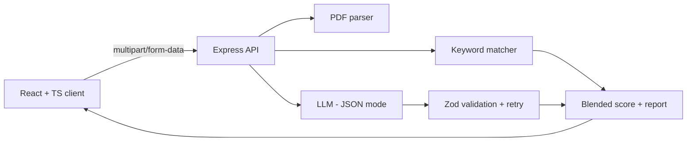

<div align="center">

# 🎯 AI Resume Analyzer

**Match any resume against a job description — get a fit score, skill gaps, resume fixes and interview questions.**


</div>

---

## ✨ Features

- **PDF / TXT resume upload** or pasted text
- **Structured LLM output** — JSON mode + **Zod schema validation**, with automatic retry on malformed responses
- **Hybrid scoring** — blends the LLM score (70%) with a deterministic keyword-match score (30%) for stable, explainable results
- **Actionable report** — matched & missing skills, strengths, concrete resume edits and tailored interview questions
- **Prompt-injection aware** — resume and JD are treated strictly as data
- **Production hardening** — Helmet, CORS, rate limiting, upload size limits, central error handling
- **Provider-agnostic** — OpenAI, Groq, Together or local **Ollama** via one env var
- **Tested & containerised** — Vitest + Supertest with a mocked LLM, Docker Compose, GitHub Actions CI

## 🏗️ Architecture



| Layer | Tech |
|-------|------|
| Frontend | React 18, TypeScript, Vite |
| Backend | Node.js 20, Express, TypeScript, Zod, Multer, pdf-parse |
| Security | Helmet, CORS, express-rate-limit |
| AI | OpenAI-compatible chat completions (JSON mode) |
| Quality | Vitest, Supertest, strict TypeScript, GitHub Actions |
| DevOps | Docker, Docker Compose, Nginx |

## 📁 Project structure

```
ai-resume-analyzer/
├── server/
│   ├── src/
│   │   ├── app.ts        # Express app factory (DI for the LLM client → testable)
│   │   ├── analyzer.ts   # prompt, validation, retry, score blending
│   │   ├── keywords.ts   # deterministic skill extraction & scoring
│   │   ├── llm.ts        # OpenAI-compatible client
│   │   ├── parse.ts      # PDF / text extraction
│   │   ├── schema.ts     # Zod contracts
│   │   └── config.ts     # validated env config
│   └── tests/
├── client/               # React + Vite UI
├── docker-compose.yml
└── .github/workflows/ci.yml
```

## 🚀 Getting started

### Docker

```bash
git clone https://github.com/hanzalasqb/ai-resume-analyzer.git
cd ai-resume-analyzer
cp server/.env.example server/.env   # add your API key
docker compose up --build
```

Open **http://localhost:3000**.

### Local development

```bash
cd server && npm install && cp .env.example .env && npm run dev   # :4000
cd client && npm install && npm run dev                            # :5173
```

## 🔌 API

`POST /api/analyze` — `multipart/form-data`

| Field | Type | Notes |
|-------|------|-------|
| `jobDescription` | text | required, 50–15,000 chars |
| `resume` | file | PDF or TXT, max 5 MB |
| `resumeText` | text | used if no file is sent |

<details><summary>Example response</summary>

```json
{
  "candidateName": "Jane Doe",
  "matchScore": 78,
  "keywordScore": 67,
  "finalScore": 75,
  "verdict": "good_fit",
  "summary": "Strong React/Node background; lacks cloud experience.",
  "matchedSkills": ["react", "typescript", "node.js"],
  "missingSkills": ["aws", "postgresql"],
  "strengths": ["Shipped production full-stack apps"],
  "improvements": ["Quantify impact, e.g. 'cut load time by 40%'"],
  "interviewQuestions": ["How would you design a rate limiter?"]
}
```
</details>

## 🧪 Tests

```bash
cd server && npm test
```

## 🗺️ Roadmap

- [ ] Bulk screening (rank many resumes for one role)
- [ ] DOCX support
- [ ] Auth + saved analyses (PostgreSQL)
- [ ] Export report as PDF

## 👤 Author

**Hanzala Saqib** — Full Stack AI Developer · [GitHub](https://github.com/hanzalasqb)

## 📄 License

MIT
